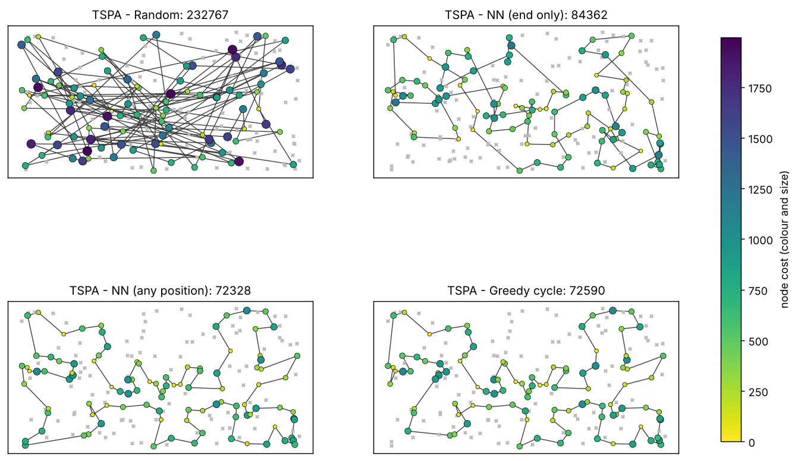
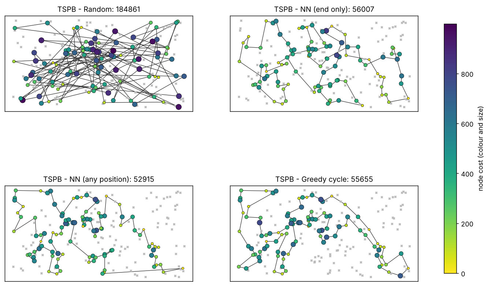

# Assignment 1: Greedy heuristics

**Author:** Jakub Laskowski (160287), Jakub Górniak (160326)
**Source code link:** [GitHub](https://github.com/Laskya/Evolutionary-Computation-PUT/tree/main/task1)  

---

## 1. The problem

We are given N nodes on a plane. Every node has integer coordinates `x`, `y` and a cost. We have to choose exactly half of the nodes (rounded up) and connect them into one closed cycle, so the number of chosen nodes is

```
K = ceil(N / 2)
```

The quality of a solution is measured by

```
objective = length of the cycle + sum of the costs of the chosen nodes
```

The cycle length is the sum of the distances between consecutive nodes, including the edge from the last node back to the first one. Distances are Euclidean and rounded to the nearest integer, so all objective values are integers. Lower is better. Both instances have N = 200, so K = 100. Each line of an instance file describes one node as `x;y;cost`.

The two parts of the objective pull in different directions. A cheap node is good for the cost part, but it can be far away from the others, and a very central node can be expensive. Because of this, "nearest" in the methods below is not understood literally. Every method picks the move with the smallest **increase of the objective function** (added distance plus the cost of the new node).

## 2. Methods

All greedy methods build the solution step by step. They start with one node and add one node at a time until K nodes are chosen. Each of them is started once from every node. If several moves are equally good, the first one found is used.

### 2.1 Increase of the objective after inserting a node

Let `v` be a node that is not chosen yet and let `c(v)` be its cost. The increase of the objective depends on where `v` is inserted:

- at the end of a path, after the last node `l`: `d(l, v) + c(v)`
- at the beginning of a path, before the first node `f`: `d(v, f) + c(v)`
- between two neighbouring nodes `a` and `b`: `d(a, v) + d(v, b) - d(a, b) + c(v)`

Here `d` is the rounded distance between two nodes. In a cycle every insertion is of the third kind, because the last node and the first node are also neighbours.

### 2.2 Random solution

This is the baseline. It chooses K different nodes at random and keeps them in the random order.

1. Choose 100 different nodes at random.
2. Visit them in the order they were chosen and return to the first one.

### 2.3 Nearest neighbor, adding only at the end

1. Start with a path containing only the starting node.
2. Repeat until the path has 100 nodes:
   - find the unchosen node `v` with the smallest `d(last node, v) + c(v)`,
   - add it at the end of the path.
3. Close the path into a cycle.

### 2.4 Nearest neighbor, adding at any position

The new node can also be placed at the beginning or between two nodes of the path. The path is open while it is built, so the closing edge is not included in the increase.

1. Start with a path containing only the starting node.
2. Repeat until the path has 100 nodes:
   - for every unchosen node, check every place in the path where it can be inserted (beginning, end, or between two neighbouring nodes),
   - choose the node and the place with the smallest increase of the objective,
   - insert the node there.
3. Close the path into a cycle.

### 2.5 Greedy cycle

This is similar to the previous method, but a closed cycle is kept all the time, so every insertion goes into one of the edges of the cycle and the closing edge is already included.

1. Start with a cycle containing only the starting node.
2. Repeat until the cycle has 100 nodes:
   - for every unchosen node, check every edge of the cycle where it can be inserted,
   - choose the node and the edge with the smallest increase of the objective,
   - insert the node into that edge.
3. Return the cycle.

For a cycle with one node the only edge goes from the node to itself and has length 0, so the first inserted node `v` costs `2 * d(start, v) + c(v)`.

## 3. Experiment setup

- 2 instances, 4 methods, 200 runs per method and instance, so **1600 solutions** in total.
- Run `r` of every greedy method starts from node `r`. With N = 200 every node is used as the starting node exactly once.
- The random method has no starting node. It makes 200 random solutions using one random generator (`mt19937`) with seed **42**, so the results can be repeated.
- The program prints the minimum, maximum and average of the objective value for each method and writes the best solution of each method to a file.

To reproduce the results:

```sh
g++ -O2 -std=c++17 -o tsp tsp.cpp
mkdir -p results
./tsp TSPA.csv TSPA results
./tsp TSPB.csv TSPB results
python3 checker.py results TSPA.csv TSPB.csv
python3 plot.py results TSPA.csv TSPB.csv
```

## 4. Results

### 4.1 Objective values

| Instance | Method | Runs | Min | Max | Average |
|---|---|---:|---:|---:|---:|
| TSPA | Random | 200 | 232,767 | 290,020 | 263,132.7 |
| TSPA | NN, end only | 200 | 84,362 | 90,075 | 87,476.6 |
| TSPA | NN, any position | 200 | 72,328 | 77,022 | 74,347.0 |
| TSPA | Greedy cycle | 200 | 72,590 | 75,281 | 73,793.4 |
| TSPB | Random | 200 | 184,861 | 227,890 | 207,121.2 |
| TSPB | NN, end only | 200 | 56,007 | 63,166 | 59,397.3 |
| TSPB | NN, any position | 200 | 52,915 | 66,164 | 59,475.5 |
| TSPB | Greedy cycle | 200 | 55,655 | 63,734 | 59,649.9 |

### 4.2 Pictures of the best solutions

The selected nodes are drawn as circles. The colour and the size show the cost of the node (small and yellow means cheap, large and dark means expensive). The grey crosses are nodes that were not selected. The title of each plot contains the objective value of the solution.





### 4.3 Best solutions as node indices

Every list is a cycle in the order of visiting. The cycle is closed, so the last node is connected to the first one. Node indices start from 0.

**TSPA**

Random, objective 232,767:
```
180, 132, 100, 152, 16, 69, 61, 187, 3, 49, 191, 10, 15, 6, 121, 193, 93, 29, 189, 48, 143, 85, 98, 181, 65, 40, 182, 90, 77, 32, 92, 188, 96, 62, 115, 155, 194, 56, 134, 82, 138, 97, 162, 53, 157, 192, 19, 54, 74, 144, 114, 196, 66, 198, 129, 120, 87, 142, 59, 185, 116, 161, 158, 2, 30, 0, 81, 106, 140, 12, 13, 167, 168, 179, 117, 195, 52, 175, 127, 51, 28, 169, 151, 130, 145, 105, 71, 108, 160, 33, 46, 156, 8, 63, 55, 41, 4, 135, 123, 31
```

NN, end only, objective 84,362:
```
54, 9, 33, 36, 177, 67, 144, 53, 135, 58, 134, 176, 174, 106, 89, 107, 57, 182, 151, 93, 50, 3, 1, 164, 178, 29, 136, 186, 184, 47, 159, 130, 153, 78, 88, 193, 170, 146, 75, 64, 150, 42, 113, 43, 85, 142, 8, 131, 84, 158, 192, 181, 114, 141, 180, 132, 76, 80, 48, 31, 63, 149, 168, 97, 127, 187, 30, 123, 152, 108, 60, 116, 49, 11, 119, 160, 83, 90, 51, 16, 35, 87, 45, 140, 52, 179, 185, 28, 102, 156, 157, 71, 91, 38, 100, 4, 112, 139, 115, 5
```

NN, any position, objective 72,328:
```
104, 129, 69, 127, 97, 168, 116, 149, 63, 11, 49, 160, 83, 123, 100, 152, 108, 60, 31, 48, 80, 91, 157, 71, 4, 76, 132, 180, 28, 102, 185, 35, 156, 51, 16, 67, 144, 140, 53, 179, 52, 177, 36, 33, 9, 54, 131, 174, 8, 164, 186, 136, 163, 29, 101, 178, 1, 169, 3, 50, 147, 47, 93, 106, 42, 89, 113, 130, 159, 146, 170, 153, 193, 78, 88, 107, 64, 57, 182, 151, 150, 176, 72, 134, 84, 58, 158, 192, 181, 114, 135, 73, 45, 87, 141, 187, 30, 189, 2, 171
```

Greedy cycle, objective 72,590:
```
31, 116, 149, 168, 63, 11, 49, 60, 108, 152, 100, 90, 123, 83, 160, 97, 127, 69, 171, 2, 189, 30, 187, 141, 87, 45, 73, 135, 114, 181, 192, 158, 58, 84, 134, 72, 176, 150, 151, 182, 57, 64, 107, 88, 78, 193, 153, 170, 146, 159, 130, 113, 89, 42, 106, 93, 47, 147, 50, 3, 169, 1, 178, 101, 29, 163, 136, 186, 164, 142, 8, 174, 131, 54, 9, 33, 36, 177, 52, 179, 53, 140, 144, 67, 16, 51, 156, 35, 185, 102, 28, 180, 132, 76, 4, 71, 157, 91, 80, 48
```

**TSPB**

Random, objective 184,861:
```
68, 78, 70, 85, 67, 88, 190, 97, 108, 73, 156, 56, 117, 39, 131, 33, 76, 123, 72, 79, 151, 98, 173, 87, 2, 21, 91, 136, 155, 135, 30, 99, 90, 95, 166, 111, 147, 146, 114, 77, 94, 129, 92, 8, 19, 154, 23, 176, 64, 49, 121, 133, 103, 75, 55, 138, 26, 3, 174, 160, 137, 102, 126, 106, 143, 0, 180, 175, 35, 162, 104, 96, 132, 167, 40, 60, 81, 10, 65, 152, 51, 198, 71, 18, 80, 62, 140, 159, 12, 196, 183, 74, 109, 172, 45, 83, 41, 120, 168, 6
```

NN, end only, objective 56,007:
```
32, 89, 57, 76, 54, 127, 129, 90, 153, 20, 14, 2, 110, 118, 56, 114, 196, 10, 148, 143, 78, 192, 162, 104, 185, 184, 3, 151, 69, 172, 133, 120, 96, 121, 198, 48, 72, 46, 86, 117, 160, 136, 8, 21, 154, 140, 47, 170, 125, 177, 6, 132, 29, 197, 175, 134, 45, 60, 40, 71, 155, 97, 115, 180, 65, 28, 149, 145, 158, 116, 147, 42, 50, 130, 30, 183, 38, 64, 85, 59, 167, 51, 87, 179, 82, 88, 171, 99, 67, 24, 34, 181, 152, 73, 98, 27, 135, 75, 79, 156
```

NN, any position, objective 52,915:
```
110, 2, 14, 20, 74, 153, 182, 52, 90, 129, 127, 80, 54, 192, 162, 104, 76, 185, 57, 89, 86, 46, 72, 3, 184, 173, 151, 122, 117, 8, 160, 69, 172, 136, 133, 120, 156, 43, 48, 96, 198, 121, 130, 191, 50, 42, 147, 116, 37, 146, 13, 149, 28, 145, 65, 158, 177, 125, 26, 170, 197, 36, 132, 29, 6, 180, 115, 155, 71, 175, 134, 45, 157, 60, 40, 141, 97, 154, 140, 47, 38, 21, 176, 30, 183, 189, 168, 64, 59, 85, 51, 73, 167, 152, 34, 24, 181, 179, 87, 82
```

Greedy cycle, objective 55,655:
```
174, 36, 197, 6, 180, 115, 170, 97, 140, 47, 155, 71, 175, 134, 45, 157, 60, 141, 40, 33, 64, 21, 189, 168, 69, 160, 172, 136, 133, 120, 8, 117, 72, 46, 86, 184, 3, 173, 122, 151, 98, 111, 27, 135, 76, 185, 162, 192, 80, 52, 182, 20, 74, 2, 93, 110, 118, 14, 153, 90, 129, 127, 54, 104, 57, 89, 156, 43, 48, 96, 198, 121, 63, 130, 191, 183, 30, 176, 38, 154, 26, 125, 177, 138, 158, 145, 149, 147, 42, 116, 37, 146, 13, 28, 65, 178, 103, 29, 132, 1
```

## 5. Solution checker

All the best solutions were checked with a separate checker program (`checker.py`). It does not use any code from the solver. It reads the instance file and the solution file again and, for every solution:

1. checks that the solution is feasible: exactly K = 100 different nodes and every index between 0 and 199,
2. builds the distances from the coordinates with the same rounding as in the solver,
3. computes the cycle length (including the edge from the last node back to the first one) and the sum of the node costs separately,
4. adds them up and compares the result with the objective value reported by the solver.

I also tried the checker on solutions that I changed on purpose (a node repeated in the list and a wrong objective value), and it reported an error in both cases.

| Instance | Method | Cycle length | Node costs | Objective (checker) | Objective (solver) | Result |
|---|---|---:|---:|---:|---:|---|
| TSPA | Random | 140,370 | 92,397 | 232,767 | 232,767 | correct |
| TSPA | NN, end only | 31,319 | 53,043 | 84,362 | 84,362 | correct |
| TSPA | NN, any position | 21,816 | 50,512 | 72,328 | 72,328 | correct |
| TSPA | Greedy cycle | 21,570 | 51,020 | 72,590 | 72,590 | correct |
| TSPB | Random | 134,927 | 49,934 | 184,861 | 184,861 | correct |
| TSPB | NN, end only | 24,632 | 31,375 | 56,007 | 56,007 | correct |
| TSPB | NN, any position | 20,068 | 32,847 | 52,915 | 52,915 | correct |
| TSPB | Greedy cycle | 19,634 | 36,021 | 55,655 | 55,655 | correct |

All eight best solutions are feasible and their objective values are confirmed by the checker. The table also shows how the objective is made up. For the random solutions most of the objective comes from the long edges (for example 140,370 of 232,767 on TSPA). For the greedy solutions the cycle is short and the node costs are the larger part (for example 21,570 against 51,020 for greedy cycle on TSPA).

## 6. Source code

The source code is available in my GitHub repository: [https://github.com/Laskya/Evolutionary-Computation-PUT/tree/main/task1](https://github.com/Laskya/Evolutionary-Computation-PUT/tree/main/task1)

## 7. Conclusions

The most important result is that the choice of the criterion matters more than anything else. All three greedy methods choose the next move by the change of the objective, and this is enough to get solutions that are about 3.5 times better than random ones: the average falls from 263,133 to about 74,000 on TSPA and from 207,121 to about 59,500 on TSPB. The solution checker table in section 5 shows what these solutions look like. After a greedy construction the cycle is short and the node costs are the bigger part of the objective, while in a random solution it is the other way round and the long edges dominate.

Among the three greedy methods there is no single winner. The table below shows which method was best in each category.

| Instance | Best minimum | Best average | Smallest spread (max - min) |
|---|---|---|---|
| TSPA | NN, any position (72,328) | Greedy cycle (73,793) | Greedy cycle (2,691) |
| TSPB | NN, any position (52,915) | NN, end only (59,397) | NN, end only (7,159) |

NN with any position is the one to choose if we only care about the best single solution, because it found the best result on both instances. It also pays for it: on TSPB its results are spread over 13,249 (about 22% of the average), which is the widest range of the three. My explanation is that it keeps the path open and never counts the edge that closes the cycle, so it can end with the first and the last node far from each other. The long edge in the bottom right corner of its TSPB solution is a good example. I did not test this explanation separately, so it is only a likely reason. Greedy cycle includes the closing edge in every decision, and on TSPA this gives it the smallest spread and the best average.

NN with end only behaves differently on the two instances. On TSPA it is clearly the worst greedy method, with an average of 87,477 against 73,793 to 74,347 for the others (about 19% worse than greedy cycle). A path that can only grow at the end has no way to come back to the nodes it skipped. On TSPB, however, its average is practically the same as that of the other two methods and it is even the best of them. I did not investigate why TSPB is easier for it, so I cannot say if it depends on how the nodes are placed or on the costs.

The methods also differ in running time. NN with end only needs O(n²) operations per run, because every step checks n candidates in one place. NN with any position and greedy cycle check every position for every candidate, so they need O(n³). For n = 200 this is not a problem, and the whole experiment takes about a second. Since the quality differs between starting nodes (for example from 52,915 to 66,164 for NN with any position on TSPB), starting from all 200 nodes and keeping the best result is worth the extra time.

All of these methods are only constructive heuristics, so none of the solutions has to be optimal. They are better used as starting solutions for a local search, which could for example exchange nodes in the cycle or reverse its parts.
